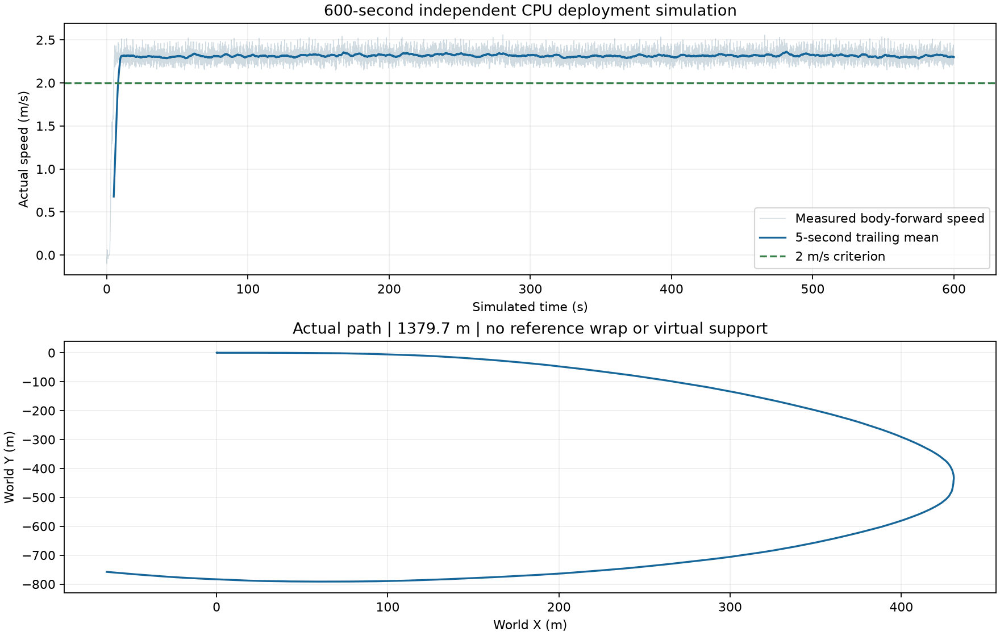

# 元气仔机器人跑步课设

基于 GMR 动作重定向、Tracking 动力学跟踪与 PPO + LS-AMP 的元气仔跑步研究。本仓库保存项目的关键代码、配置、最终推理策略、参考动作和实验记录，作为课程设计的精简备份。

**当前处于仿真阶段，实机尚未连接。** 已完成跑步参考动作重定向、短片段 Tracking、指令驱动跑步训练及独立 CPU 部署仿真。随机参数下的停止与转向检查仍未全部通过，不能视为已完成 sim2real。

结果基线日期：2026-10-20。此备份以当前 Windows 项目目录中已同步的文件为准；本次未能重新登录训练主机核对最新文件，不包含仅保存在远端的训练日志和检查点。

## 1. 项目目标

| 最终实机验收项 | 权重 | 目标 |
| --- | --- | --- |
| 速度 | 30% | 平均跑步速度不低于 2 m/s |
| 地形适应 | 30% | 适应室外柏油路及崎岖路面 |
| 低功耗与续航 | 20% | 连续奔跑时间不低于 10 分钟 |
| 稳定性 | 20% | 起步、停止、转弯平顺，无明显抖动、踉跄或失衡 |

仿真速度和运行时长是阶段结果，不能代替实机的地形、续航、温升与稳定性验收。

## 2. 跑步动作与视频动作分别来自哪里

### 跑步训练主线

1. 选取 Ubisoft LAFAN1 的 `run2_subject4.bvh`，使用零起始帧号 `[6940, 7060)` 的 120 帧动作，原始帧率 30 Hz。
2. 通过 GMR/Mink IK 适配元气仔实际 29 关节模型，生成 50 Hz 机器人参考轨迹。保留原动作时间尺度。
3. 从官方 Tracking actor 初始化，训练并验证有限跑步片段的动力学跟踪。
4. 采集 Tracking 策略的 32 段真实仿真轨迹，形成 5440 对相邻状态转移，作为后续 LS-AMP 动态专家数据。
5. 从官方行走策略 actor 初始化，使用 PPO + LS-AMP 训练接收前向速度、侧向速度和转向角速度指令的跑步策略，加入域随机化与合成地形课程。

**当前跑步参考来自开源动捕数据。** 指令策略从静止站姿起步，由策略、PD、重力和接触推进，不循环播放 3.92 秒参考动作，也不在片段末尾传送机器人。

### 视频动作验证支线

自摄动作、太极拳视频经 GVHMR 恢复为 SMPL-X 人体运动，再由 GMR 重定向到元气仔。这条支线用于验证视频输入与动作复现，未作为当前跑步策略的专家来源。

- 自摄动作：已完成重建、重定向和实验性 Tracking；可完成短片段，但跟踪精度仍未通过预设验收。
- 太极拳：已完成整段重定向及上肢自碰撞修正；尚未训练太极拳 Tracking，也未验证自由动力学稳定性。

## 3. 当前实验结果

| 验证内容 | 结果 | 适用范围 |
| --- | --- | --- |
| 跑步 Tracking | 3.92 秒片段；温和扰动下 96/96 完成；名义前向均速 1.833 m/s；关节角 RMSE 0.113 rad | 从参考姿态与速度初始化，属于有限片段验证 |
| CPU MuJoCo 连续跑 | 600 秒无摔倒；含起跑全程前向均速 2.302 m/s；稳态 2.315 m/s；实际路径 1379.68 m | 名义平地、速度指令 2.4 m/s，仍有累计偏航 |
| 合成崎岖地形 | 3 个新评估种子，各 128 环境、25 秒；374/384 完成（97.40%）；各组稳态均速约 2.05–2.07 m/s | 同时随机化动力学参数、延迟、推扰和观测噪声，仍有 10 次失败 |
| 名义平地起停左右转 | 16/16 完成；最差停止后速度 0.106 m/s，持续转向偏差 0.073 rad/s | 通过当前工程检查 |
| 随机参数起停左右转 | 32/32 完成；停止后速度 0.165 m/s，持续转向偏差 0.124 rad/s | 未通过严格停止/转向检查 |
| ONNX 导出一致性 | 最大动作绝对误差约 1.91×10⁻⁶ | 当前交付策略与 PyTorch 的动作核对 |

总检查文件为 [`simulation_acceptance.json`](running_sim_pipeline/artifacts/simulation_acceptance.json)，`all_listed_simulation_checks_passed` 仍为 **false**。600 秒平地与短时崎岖地形是分别进行的试验；目前没有同一次“崎岖地形 + 600 秒”的通过证据。



机械功率代理约为 261.49 J/m，不等于电池侧功耗。尚未完成硬件标定、电池续航、温升测试或多训练种子的 AMP 消融；仿真资产的质量与力矩能力也需实机辨识。

## 4. 目录说明

| 路径 | 作用 |
| --- | --- |
| `running_sim_pipeline/` | 指令跑步任务、PPO/AMP、域随机化、评估与部署审计 |
| `running_sim_pipeline/configs/` | 各阶段训练配置、运行清单及可获得的源码快照 |
| `running_sim_pipeline/artifacts/running_policy.onnx` | 最终跑步推理策略 |
| `running_sim_pipeline/assets/dynamic_amp_expert.npz` | 已采集的动态 AMP 专家，配套 JSON 记录来源与哈希 |
| `motion_pipeline/` | LAFAN1 跑步选段、GMR 适配、Tracking 训练与独立部署评估 |
| `motion_pipeline/artifacts/motion/` | 选定跑步参考、映射与关节顺序 |
| `video_motion_pipeline/` | 视频人体运动恢复、GMR 重定向及实验性 Tracking |
| `taichi_motion_pipeline/` | 太极拳重定向、FCL 自碰撞检测与修复 |
| `honor_diagnostics/` | 最初行走模型与官方策略的诊断和对照 |
| `backup_policy.json` | 关键文件的备份选择规则 |
| `BACKUP_MANIFEST.json` | 本次备份文件的字节数与 SHA-256，不包含清单自身 |
| `tools/prepare_backup.mjs` | 生成备份清单、更新 Git 忽略规则、检查凭据与文件完整性 |

进一步阅读：[跑步训练与验证](running_sim_pipeline/README.md)、[跑步重定向与 Tracking](motion_pipeline/README.md)、[视频支线](video_motion_pipeline/README.md)、[太极拳及自碰撞修正](taichi_motion_pipeline/README.md)、[课设技术方案](荣耀元气仔跑步课设技术方案.md)、[另一台主机部署步骤](另一台主机部署与开展步骤.md)。

子目录 README 与历史报告保留了原训练主机路径、运行命令和历史链接。其中的视频、训练检查点等可能不在精简仓库内；以本页备份范围和 `BACKUP_MANIFEST.json` 为准。

## 5. 备份范围

保留核心 Python/Bash 源码、依赖说明、训练配置、最终跑步与 Tracking ONNX、跑步参考、动态专家、最终太极拳参考、关键测试 JSON、少量结果图、版本与许可信息。

不提交原始/生成视频、人体模型与 GVHMR 大模型权重、完整 `.pt/.pth` 训练检查点、训练日志、环境与缓存、完整第三方仓库、SDK 安装包、PDF 手册、PPT 及演示构建临时文件。原文件仍保留在本地；本仓库不是完整工作空间的逐字节镜像。

最终跑步 ONNX 来自稳定性 4400 检查点的 40% 与精调 4600 检查点的 60% 固定权重平均。来源见 [`averaged_4400_4600.provenance.json`](running_sim_pipeline/artifacts/averaged_4400_4600.provenance.json)。**ONNX 只能推理，不能恢复 PPO 优化器和 AMP 状态。** 续训需要另外恢复原始训练检查点；平均检查点本身也不用于 PPO 续训。

## 6. 在另一台机器恢复仿真

运行环境为 Linux + NVIDIA GPU；Windows 本地目录主要用于备份与查看。以下命令在 Ubuntu Bash 中执行。仓库根目录就是脚本识别的工作空间，官方框架和 GMR 应放在其下，与各 pipeline 同级。

### 6.1 获取仓库及官方训练框架

```bash
git clone https://github.com/YeLuo-123/vitaboy-running-course-project.git
cd vitaboy-running-course-project
git clone https://github.com/HonorRobotics/honor_rl_mjlab.git
git -C honor_rl_mjlab checkout 10c2ba02c7c001bb574771855b9dc41ef193e01d
git -C honor_rl_mjlab lfs pull
cd honor_rl_mjlab
uv sync --locked --python 3.12
cd ..
```

需事先安装 Git LFS、uv 和可用的 NVIDIA 驱动；如果官方资产需要额外访问权限，应使用自己的授权。锁定环境的安装和 GPU 检查步骤见部署文档，不要用通用 `pip install mjlab` 替代项目锁定环境。

已记录的实际训练环境：Python 3.12.15、mjlab 1.5.2、MuJoCo 3.10.0、MuJoCo-Warp 3.10.0.2、PyTorch 2.13.0。完整包版本、官方提交与资产哈希见 [`environment_and_source.json`](running_sim_pipeline/artifacts/environment_and_source.json)。这些是历史实验环境记录，不是新机器上已验证的安装结果。

### 6.2 验证备份并恢复 Tracking 引用路径

```bash
# 可选完整性检查，需要 Node.js 18+
node tools/prepare_backup.mjs --verify

# Tracking 脚本从 data/ 读取参考；备份将参考集中保存在 artifacts/motion/
mkdir -p motion_pipeline/data/retargeted/lafan_run2_s4_geometry
cp motion_pipeline/artifacts/motion/run.npz \
  motion_pipeline/data/retargeted/lafan_run2_s4_geometry/run.npz
```

### 6.3 使用现有最终策略进行独立 CPU 仿真

```bash
cd honor_rl_mjlab
MUJOCO_GL=egl .venv/bin/python ../running_sim_pipeline/evaluate_cpu.py \
  --policy ../running_sim_pipeline/artifacts/running_policy.onnx \
  --speed 2.4 --duration 600 \
  --output ../running_sim_pipeline/results/restored_cpu_600s.json
```

该脚本运行仿真，不向实机发送控制。是否能在新机器复现同样数值应重新评估，不能直接沿用历史 JSON 作为新实验成绩。

### 6.4 重新生成动作与继续训练

- 跑步重定向：按 `motion_pipeline/README.md` 获取固定版本 GMR 与 LAFAN1，并安装 `requirements_retarget.txt`。视频支线还需固定版本 GMR 的 `utils/smpl.py` 等模块。
- 视频重建：另建 GVHMR 的 Python 3.10 环境，按视频 README 与上游许可准备输入、人体模型和推理权重。训练环境与重建环境分开。
- 跑步重新训练：可使用备份的参考与动态专家，按跑步 README 的 `flat`、`robust`、`rough` 阶段执行。重新采集专家会改变数据哈希，不能与旧 AMP 状态混用。
- 续训原实验：先从本地完整目录或训练主机恢复 `motion_pipeline/artifacts/model_500.pt`、所需跑步源检查点及日志；这些文件不在 Git 备份中。需要生成 GPU 评估或重新导出策略时同样可能需要训练检查点。
- 太极拳：修正后的参考在 `outputs/vita_boy_collision_free/`；FCL 依赖见 `collision_requirements.txt`。继续修复需要另行恢复人体骨架和旧参考等中间输入。

固定上游版本：Honor 训练仓库 `10c2ba02c7c001bb574771855b9dc41ef193e01d`；GMR `bb1bbe40774794fceb2a7c579a3464a28e68c844`；GVHMR `ee960bb6e2ea2d381aa97f08e9b71ef320b624b1`。

## 7. 后续更新备份

在仓库根目录执行：

```bash
node tools/prepare_backup.mjs
git status --short
git add .
git diff --cached --stat
git commit -m "Update simulation source and evaluation records"
git push origin main
```

`prepare_backup.mjs` 按 `backup_policy.json` 重新选择关键文件并生成精确 `.gitignore`。新增源码会被对应目录规则选中；新增结果或大文件需要先明确加入备份规则。请先查看暂存清单。历史交付清单描述原完整目录，本次实际备份由 `BACKUP_MANIFEST.json` 描述。

## 8. 第三方来源

- [HonorRobotics/honor_rl_mjlab](https://github.com/HonorRobotics/honor_rl_mjlab)：官方训练框架、模型资产与初始策略。
- [Ubisoft LAFAN1](https://github.com/ubisoft/ubisoft-laforge-animation-dataset)：人体跑步动捕数据；原许可见 `motion_pipeline/artifacts/provenance/LAFAN1_license.txt`。
- [GMR](https://github.com/YanjieZe/GMR)：通用动作重定向；固定源码快照与许可随相应 provenance 目录保留。
- [GVHMR](https://github.com/zju3dv/GVHMR)：视频人体运动恢复；保留来源、版本及原许可。

本仓库用于项目备份，不对第三方代码、数据、模型或派生成果重新授权。人体模型、大模型权重与数据的获取和使用遵循各自原始条款；仓库可见性变化前应重新核对拟共享内容。
