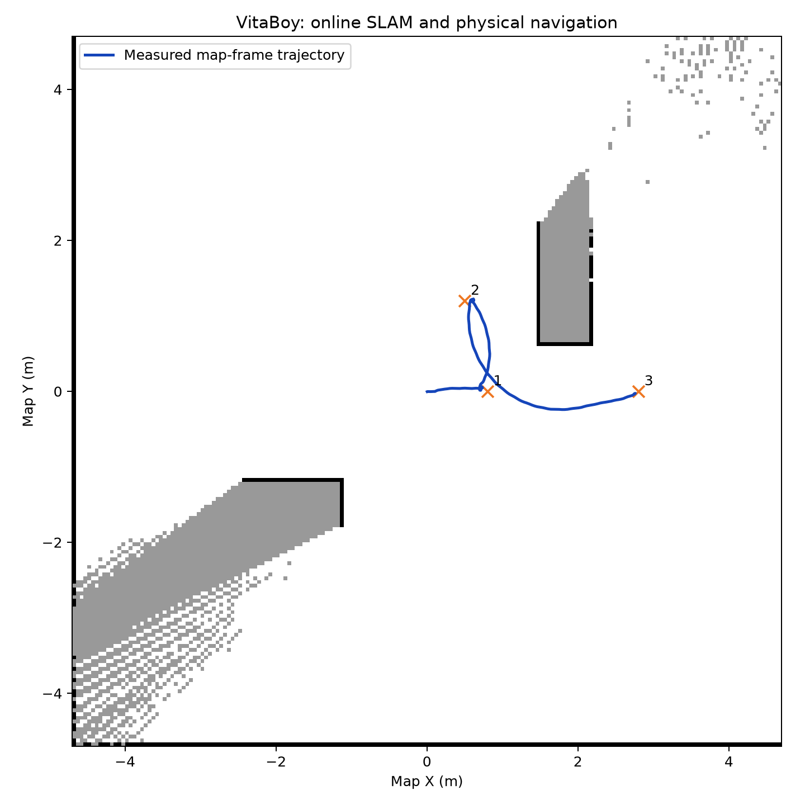

# 元气仔SLAM与导航迁移：仿真测试记录

## 更新：训练跑步策略 + 在线建图导航 + RViz同步录像（2026-10-21）

已使用之前训练的 `running_sim_pipeline/artifacts/running_policy.onnx` 完成三目标闭环导航。该文件 SHA-256 为 `044b5247ed35e15ad6b343ea537d70b809914c1f5ea6e659ea581a7b7f6dbb2b`，没有换成官方行走策略，也没有用参考动作传送基座。

先看 [双画面演示视频](results/running_demo/running_slam_rviz_demo.mp4)，另保留 [完整原始录像](results/running_demo/running_slam_rviz.mp4)。左侧是这次实际MuJoCo动力学仿真，右侧是同一运行中真正的RViz2窗口，显示在线SLAM地图、红色激光、编号目标、绿色规划路径和青色实际轨迹。叠加栏显示仿真时间、实际速度和当前目标。演示版从仿真30.3秒起，省略前段静止等待，时长55.65秒，不加速；原始录像约85.95秒，1920×768、20 FPS。

| 项目 | 本次结果 |
| --- | --- |
| 目标1 `(13.5,0.0)` | 到达，首次进入范围时误差0.2940m |
| 目标2 `(13.5,8.0)` | 到达，误差0.2981m |
| 目标3 `(1.0,8.0)` | 绕过中间障碍后到达，误差0.2915m |
| 到达阈值 | 0.30m；每个目标后保留2秒稳定时间 |
| 动力学 | 85.94秒，无摔倒、无障碍物接触 |
| 跑步速度 | 最高1秒平均前向速度2.100m/s；10 Hz采样中速度≥2m/s共约1.4秒 |
| 无效目标与停车 | 障碍内目标被拒绝，末段平均平面速度0.0501m/s |
| 在线SLAM | 83次地图消息，147057个已知格、2173个占用格 |
| 状态频率 | 实测里程计46.48 Hz、激光15.00 Hz，按仿真时间计算 |
| 检查 | 12项协议/规划单元测试、4项几何检查、16项膨胀等价检查通过；13项交付验收检查通过 |

运行记录见 [acceptance.json](results/running_demo/acceptance.json)、[integration.json](results/running_demo/integration.json)、[simulation.json](results/running_demo/simulation.json)，地图与轨迹见 [slam_navigation.png](results/running_demo/slam_navigation.png)。策略、源码和录像哈希见 `results/running_demo/provenance.json`。

本次采用21×18m合成平地房间、理想里程计与水平稳定的360束合成激光，激光最大量程16m。地图仍由 `slam_toolbox` 从在线扫描生成。大地图膨胀改用等价的欧氏距离变换；跑步模式使用带朝向状态的A*和拐角碰撞检查，保留未知区域拒绝、数据超时停车及基于距离的减速。原G1源码未改。官方行走模式仍为默认值。

这是一个场景中的三个连续目标，不是独立场景成功率。导航包含起步、转弯、绕障和停止，不能把短时速度峰值解释为全程均速≥2m/s。未测试传感器噪声、真实雷达、真实里程计或实机。

复现（4080主机）：

```bash
cd ~/honor_ws/vitaboy_navigation
bash scripts/build.sh
bash scripts/run_running_demo.sh
```

脚本会创建独立结果目录、启动虚拟显示与真实RViz、运行训练跑步策略及在线SLAM、录制同步画面并汇总验收；结束后关闭它自己启动的进程。无sudo权限时，Xvfb以下载deb后解包到 `.capture_runtime` 的方式使用，不修改系统安装。

## 历史记录：官方行走策略的低速导航

测试日期：2026-10-21。测试主机：4080 / NVIDIA GeForce RTX 4080 SUPER；ROS 2 Humble；MuJoCo 3.10.0；物理执行环境Python 3.12.15。

## 结论与适用范围

本次已完成G1导航前端到元气仔官方行走策略的基本迁移，并运行真实ROS 2在线建图与MuJoCo关节动力学闭环。最终同一房间的3个连续目标全部完成，实际物理运行40.90秒，没有摔倒或障碍物接触。无效目标被拒绝，随后停车。

这是**一个合成静态场景、理想里程计和理想二维扫描下的功能验证**。3个连续目标不是3个独立环境，不代表泛化成功率。没有进行真实传感器、实机、高速跑步导航或长期回环精度测试。

## 最终结果

| 检查 | 实测结果 | 本次结论 |
| --- | --- | --- |
| 在线SLAM | slam_toolbox发布38次地图；最终32758个已知格、455个占用格 | 已运行，地图由扫描生成 |
| 实际里程计频率 | 50.00 Hz，按仿真时间统计 | 通过 |
| 激光频率 | 15.005 Hz，按仿真时间统计 | 通过 |
| 目标1 `(0.8,0)` | 到达误差0.1759m，约2.79秒 | 通过18cm判据 |
| 目标2 `(0.5,1.2)` | 到达误差0.1766m，约10.34秒 | 通过，含转向 |
| 目标3 `(2.8,0)` | 到达误差0.1772m，约21.78秒 | 通过，路径绕过障碍物 |
| 障碍物内/未知目标 `(1.8,1.4)` | 规划输出空路径 | 通过拒绝检查 |
| 拒绝目标后停车 | 最后采样窗平均平面速度0.00582m/s | 通过0.08m/s判据 |
| 物理状态 | 无摔倒、无障碍物接触；没有虚拟支撑或参考传送 | 通过 |
| 独立22秒底层控制 | 前进段均速0.218m/s；停止段0.00193m/s；转向段0.181rad/s | 通过 |
| 协议与控制单元检查 | 9项 | 通过 |
| ROS规划几何检查 | 4项，含禁止从占用格拐角切过 | 通过 |

目标误差取机器人首次进入18cm到达范围时的位置；目标间直接切换，不表示每个目标都已保持停车。停车单独在最终无效目标拒绝后检验。原始记录见 `results/integration.json` 和 `results/simulation.json`，汇总见 `results/acceptance.json`。

官方策略SHA-256：`e83e01c35498f900e218212f406110546a0f5f0db4ca51919f075ab30701d5e6`。



实际视频为 `results/navigation.mp4`。蓝线来自实际地图坐标轨迹，地图来自slam_toolbox输出；没有把预设场景几何画成SLAM地图。

## 迁移中发现并处理的问题

1. 原默认G1启动入口发布空白地图，本次改为在线slam_toolbox，并由它单独发布map→odom。
2. 原规划和跟踪直接使用里程计位置，本次先变换到SLAM地图坐标，避免map与odom偏移时导航坐标错配。
3. 元气仔对很小的前进/转向命令可能停在站立状态，加入低速补偿与先转向控制。
4. 原局部排斥算法随扫描束数量累加，在本次360束激光下产生过强侧推。改为限制朝障碍物方向的接近速度，保持切向运动。
5. 初始规划膨胀距离与局部制动距离不协调，绕障目标曾被制动停住。本次采用0.65m保守膨胀和0.50m局部制动间距，并增加路径拐角检查；最终更换为满足该规划间距的测试目标。

早期失败试次保留在 `results/integration_*_failure.json` 等文件，不纳入最终通过统计。当前参数针对这一场景；增加狭窄通道或改变机器人速度、外形和传感器时应重新验证。

## 复现

在4080主机执行：

```bash
cd ~/honor_ws/vitaboy_navigation
bash scripts/build.sh
bash scripts/run_test.sh
```

需要交互窗口时，在该主机图形桌面终端执行 `bash scripts/run_interactive.sh`。自动测试已经退出，不会持续向仿真发送导航命令。
